# McKinsey AI Market Research & Strategy Engine

Production-oriented AI market intelligence platform for consultants, strategy teams, reviewers, and administrators. The application turns research intake into governed research jobs, AI-assisted analysis, evidence validation, report generation, dashboard monitoring, knowledge memory, uploads, notifications, and audit-backed review workflows.

The repository contains a Next.js frontend, an Express/MongoDB backend, LangGraph research orchestration, DeepSeek-powered analysis, Tavily/Firecrawl/Playwright source collection, and Qdrant-backed semantic memory using local Transformers.js/ONNX text embeddings.

## Live Deployment

| Component | Live URL |
|---|---|
| **Web application** | [live URL](https://agentic-research-strategy-engine.vercel.app/) |
| **Interactive API documentation (Swagger UI)** | [Open API docs](https://agentic-research-strategy-api.onrender.com/api-docs) |
| **Backend health check** | [Check API health](https://agentic-research-strategy-api.onrender.com/health) |

The web application uses the Next.js API proxy to forward browser API requests to the Render backend. Most API endpoints require authentication; the health check and API documentation are public.

## Table of Contents

- [Live Deployment](#live-deployment)
- [Features](#features)
- [Tech Stack](#tech-stack)
- [Architecture](#architecture)
- [Project Workflow](#project-workflow)
- [Folder Structure](#folder-structure)
- [Prerequisites](#prerequisites)
- [Installation and Setup](#installation-and-setup)
- [Environment Variables](#environment-variables)
- [Running the Application](#running-the-application)
- [API Documentation](#api-documentation)
- [Screenshots and Visual Assets](#screenshots-and-visual-assets)
- [Testing](#testing)
- [Deployment](#deployment)
- [Troubleshooting](#troubleshooting)
- [Future Enhancements](#future-enhancements)
- [Contributors](#contributors)
- [License](#license)
- [References and Documentation](#references-and-documentation)

## Features

| Area | Capabilities |
|---|---|
| Authentication and governance | Signup, login, token refresh, JWT authentication, role-based access control for `consultant`, `reviewer`, and `admin` users. |
| Research workflow | One-submit research intake, automatic planning and plan approval, background workflow execution, progress tracking, failure handling, and report generation. |
| AI analysis | DeepSeek-backed assistant chat and structured dashboard analysis with deterministic fallback behavior when AI quota or model access is unavailable. |
| Evidence management | Source-linked evidence records, confidence scores, reviewer approval/rejection/flagging, and scoped access by role. |
| Reports | Report listing, report detail, feedback capture, and export to Markdown, CSV, PDF, and DOCX. |
| Dashboard analytics | MongoDB aggregation for active jobs, reports, evidence, uploaded files, connected data sources, trends, competitors, validation status, runtime, and recent activity. |
| Knowledge base | MongoDB-backed knowledge memory with collection, tags, industry, geography, competitors, confidence, and Qdrant semantic search using local text embeddings. |
| Upload data hub | Multi-file upload support for PDF, DOCX, XLSX, CSV, PPT, and PPTX files up to 50 MB each, eight files per request. |
| Search and navigation | Global search across research jobs, reports, knowledge records, and uploaded files. |
| Notifications | User notification list, unread counts, single notification read updates, and mark-all-read action. |
| Frontend workspaces | Dashboard, research intake, workflow monitor, reports, evidence review, market intelligence, competitive analysis, forecasting, AI assistant, knowledge base, upload/data hub, data sources, operations, settings, and strategy framework pages. |

## Tech Stack

### Frontend

| Technology | Usage |
|---|---|
| Next.js 15 | App Router frontend application. |
| React 19 | UI rendering. |
| Tailwind CSS | Styling system. |
| Redux Toolkit and React Redux | Client state management. |
| TanStack React Query | Server-state data fetching. |
| Axios | API client with bearer-token interceptor. |
| Recharts | Dashboard and analysis charts. |
| Framer Motion | UI motion. |
| Lucide React | Iconography. |
| Jest and Testing Library | Frontend tests. |

### Backend

| Technology | Usage |
|---|---|
| Node.js 24.x | Backend runtime target (matches the project package engine). |
| Express 4 | REST API server. |
| MongoDB and Mongoose | Primary persistence layer. |
| JWT and bcrypt | Authentication, refresh tokens, and password hashing. |
| Zod | Request validation. |
| LangGraph and LangChain Core | Research workflow orchestration. |
| DeepSeek API | Planning, analysis, extraction, aggregation, and report-writing intelligence. |
| Tavily | Search provider for research workflows. |
| Firecrawl | Optional page crawling/markdown extraction. |
| Playwright | Browser-based content retrieval. |
| Transformers.js and ONNX Runtime | Local text embedding generation with the `all-MiniLM-L6-v2` ONNX model (384-dimensional vectors). |
| Qdrant | Vector storage and semantic retrieval for knowledge memory. |
| Helmet, CORS, compression, morgan, express-rate-limit | Production API hardening and observability basics. |
| Multer | In-memory upload handling. |
| PDFKit and docx | Report export generation. |
| Jest and Supertest | Backend tests. |

## Architecture

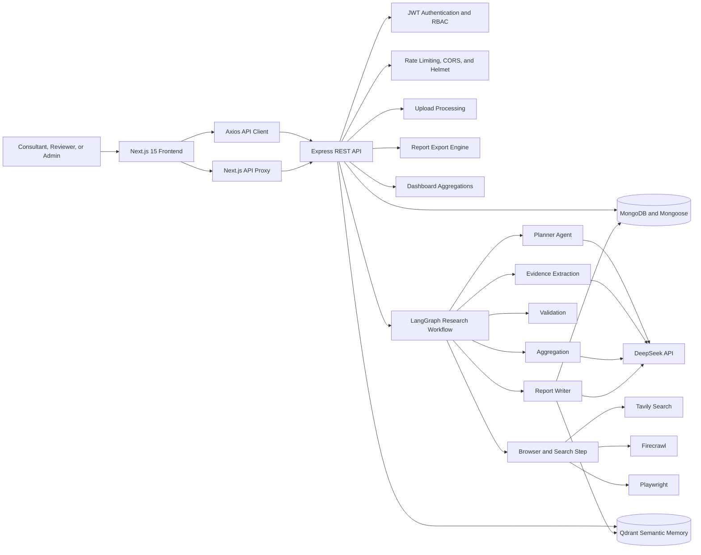

The backend is the workflow authority. The frontend renders API data and uses `/api` as the browser-facing endpoint. Set `API_URL` to the local backend during development and to your own Render backend URL in Vercel.

## Project Workflow

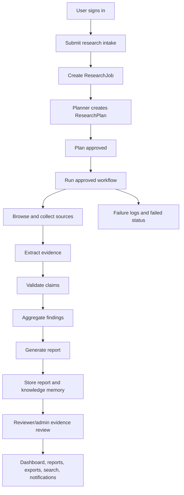

## Folder Structure

```text
McKinsey_Agentic_Research_Strategy_Engine/
|-- README.md
|-- backend/
|   |-- .env.example
|   |-- package.json
|   |-- src/
|   |   |-- agents/                 # LangGraph research workflow
|   |   |-- controllers/            # Route handlers
|   |   |-- middleware/             # Auth, RBAC, and error handling
|   |   |-- models/                 # Mongoose models
|   |   |-- routes/                 # Express route definitions
|   |   |-- services/               # DeepSeek, Tavily, Firecrawl, Playwright, Qdrant
|   |   |-- utils/                  # DB, tokens, audit helpers
|   |   |-- app.js                  # Express app factory
|   |   `-- server.js               # API entry point
|   `-- tests/                      # Backend Jest/Supertest tests
|-- frontend/
|   |-- .env.example
|   |-- package.json
|   |-- vercel.json
|   |-- app/
|   |   |-- (auth)/                 # Login, signup, forgot password
|   |   |-- (dashboard)/            # Authenticated dashboard pages
|   |   |-- api/[...path]/route.js  # Next.js API proxy
|   |   |-- globals.css
|   |   |-- layout.js
|   |   `-- page.js
|   |-- components/                 # Shell, auth, dashboard, and UI components
|   |-- hooks/
|   |-- lib/                        # API client and utilities
|   |-- redux/
|   `-- tests/                      # Frontend Jest tests
|-- docs/
|   |-- API.md
|   |-- ARCHITECTURE.md
|   |-- DEPLOYMENT.md
|   |-- DEEPSEEK_RELIABILITY.md
|   `-- TESTING.md
|-- charts/                         # Generated market strategy charts
|-- reports/                        # Generated final Markdown report
|-- output/
|   |-- html/                       # Generated report HTML
|   `-- pdf/                        # Generated report PDF and preview screenshot
`-- scripts/
    `-- generate_final_report.mjs
```

## Prerequisites

| Requirement | Version / Notes |
|---|---|
| Node.js | `24.x` for both backend and frontend (matches the package engine declarations). |
| npm | Required for dependency installation and scripts. |
| MongoDB | Local MongoDB is supported for development; MongoDB Atlas is recommended for production. |
| DeepSeek API key | Required for AI planning, assistant, extraction, aggregation, and report generation. |
| Tavily API key | Required for Tavily-backed research search. |
| Firecrawl API key | Optional page crawling support; the service returns `null` when not configured. |
| Qdrant URL/API key | Required for Qdrant-backed semantic memory and search; local MongoDB text search can still be used for knowledge lookup. |
| Playwright browser binaries | Required when workflow execution needs browser retrieval. |

## Installation and Setup

Clone the repository and install dependencies for both applications:

```bash
git clone https://github.com/almabetter-school-ds/agentic-research-strategy-engine.git
cd agentic-research-strategy-engine
```

Install backend dependencies:

```bash
cd backend
npm install
```

Install frontend dependencies:

```bash
cd ../frontend
npm install
```

Create local environment files:

```bash
cd ..
copy backend\\.env.example backend\\.env
copy frontend\\.env.example frontend\\.env.local
```

On macOS/Linux, use:

```bash
cp backend/.env.example backend/.env
cp frontend/.env.example frontend/.env.local
```

For local development without Atlas, make sure MongoDB is running and use:

```bash
MONGODB_URI=mongodb://127.0.0.1:27017/market_research_engine
```

## Environment Variables

### Backend `.env.example`

```bash
NODE_ENV=development
PORT=8080
CORS_ORIGIN=http://localhost:3000,http://localhost:3001,http://localhost:3010
MONGODB_URI=mongodb+srv://strategy_engine_app:<URL_ENCODED_PASSWORD>@<YOUR_ATLAS_HOST>/strategy_engine?retryWrites=true&w=majority
# MONGO_URL is also supported for MongoDB Atlas compatibility.
JWT_ACCESS_SECRET=replace-with-long-random-access-secret
JWT_REFRESH_SECRET=replace-with-long-random-refresh-secret
# JWT_ACCESS_EXPIRES_IN=15m
JWT_REFRESH_EXPIRES_IN=7d
DEEPSEEK_API_KEY=
DEEPSEEK_MODEL=deepseek-v4-flash
# Optional only if available in your API account and approved for cost: DEEPSEEK_MODEL_FALLBACKS=deepseek-v4-pro
TAVILY_API_KEY=
FIRECRAWL_API_KEY=
QDRANT_URL=
QDRANT_API_KEY=
EMBEDDING_MODEL=onnx-community/all-MiniLM-L6-v2-ONNX
RESEARCH_TIMEOUT_MS=45000
EXTRACTION_PROMPT_CONTENT_CHARS=6000
RATE_LIMIT_PER_MINUTE=120
MONGODB_SERVER_SELECTION_TIMEOUT_MS=10000
MONGODB_CONNECT_TIMEOUT_MS=10000
MONGODB_SOCKET_TIMEOUT_MS=45000
MONGODB_TLS_ALLOW_INVALID_CERTIFICATES=false
DNS_SERVERS=8.8.8.8,1.1.1.1
```

| Variable | Required | Description |
|---|---:|---|
| `NODE_ENV` | Yes | Runtime environment. Production mode changes logging and requires a MongoDB URI. |
| `PORT` | Yes | Express server port. Defaults to `8080` in the example. |
| `CORS_ORIGIN` | Production | Comma-separated list of allowed frontend origins. Local development ports are enabled by default; set your own Vercel origin for production. |
| `MONGODB_URI` | Production | MongoDB connection string. In development, the backend falls back to `mongodb://127.0.0.1:27017/market_research_engine` when unset. |
| `MONGO_URL` | Optional | Alternate MongoDB connection variable supported by the DB utility. |
| `JWT_ACCESS_SECRET` | Yes | Secret used to sign short-lived access tokens. |
| `JWT_REFRESH_SECRET` | Yes | Secret used to sign refresh tokens. |
| `JWT_ACCESS_EXPIRES_IN` | Optional | Access-token lifetime. Defaults to `15m` in code. |
| `JWT_REFRESH_EXPIRES_IN` | Yes | Refresh-token lifetime. Defaults to `7d` in the example. |
| `DEEPSEEK_API_KEY` | AI features | DeepSeek API key. Required by DeepSeek-backed services. |
| `DEEPSEEK_MODEL` | Optional | Primary DeepSeek model. Example uses `deepseek-v4-flash`. |
| `DEEPSEEK_MODEL_FALLBACKS` | Optional | Comma-separated fallback DeepSeek models. |
| `TAVILY_API_KEY` | Research search | Tavily search API key. Missing keys return a `503` from Tavily-backed service calls. |
| `FIRECRAWL_API_KEY` | Optional | Firecrawl API key for page crawling. If unset, Firecrawl service returns `null`. |
| `QDRANT_URL` | Semantic memory | Qdrant endpoint URL. |
| `QDRANT_API_KEY` | Semantic memory | Qdrant API key. |
| `EMBEDDING_MODEL` | Optional | Hugging Face Transformers.js model used to generate Qdrant vectors. Defaults to `onnx-community/all-MiniLM-L6-v2-ONNX` (384 dimensions). The service needs outbound internet access to download the model on first use unless it is already cached. |
| `RESEARCH_TIMEOUT_MS` | Optional | Timeout used by Tavily, Firecrawl, and Playwright research calls. |
| `EXTRACTION_PROMPT_CONTENT_CHARS` | Optional | Maximum source content characters included in extraction prompts. |
| `RATE_LIMIT_PER_MINUTE` | Optional | API rate limit per minute. Defaults to `120`. |
| `MONGODB_SERVER_SELECTION_TIMEOUT_MS` | Optional | MongoDB server selection timeout. |
| `MONGODB_CONNECT_TIMEOUT_MS` | Optional | MongoDB connection timeout. |
| `MONGODB_SOCKET_TIMEOUT_MS` | Optional | MongoDB socket timeout. |
| `MONGODB_TLS_ALLOW_INVALID_CERTIFICATES` | Local troubleshooting only | Allows invalid TLS certificates for local Atlas troubleshooting. Do not enable in production. |
| `DNS_SERVERS` | Optional | Comma-separated DNS servers used to work around Atlas SRV lookup failures. |

### Frontend `.env.example`

```bash
# Local development:
API_URL=http://localhost:8080
NEXT_PUBLIC_API_URL=/api
# Production on Vercel:
# NEXT_PUBLIC_API_URL=/api
```

| Variable | Required | Description |
|---|---:|---|
| `NEXT_PUBLIC_API_URL` | Yes | Browser-visible API base URL. The frontend normalizes values to include `/api` when needed. Local example uses the Next.js API proxy. |
| `API_URL` | Optional | Server-side origin used by `frontend/app/api/[...path]/route.js` to proxy `/api/*` requests to the backend. Defaults to `http://localhost:8080` for local development. Set it to your own Render backend URL on Vercel. |

## Running the Application

Run the backend API:

```bash
cd backend
npm run dev
```

The backend listens on:

```text
http://localhost:8080
```

Run the frontend in a separate terminal:

```bash
cd frontend
npm run dev
```

Open the frontend:

```text
http://localhost:3000
```

Production-style local run:

```bash
cd backend
npm start
```

```bash
cd frontend
npm run build
npm start
```

## API Documentation

### Base URL

| Environment | Base URL |
|---|---|
| Local backend | `http://localhost:8080` |
| Local API prefix | `http://localhost:8080/api` |
| Production backend | `https://agentic-research-strategy-api.onrender.com` |
| Production API prefix | `https://agentic-research-strategy-api.onrender.com/api` |
| Interactive API docs (Swagger UI) | [https://agentic-research-strategy-api.onrender.com/api-docs](https://agentic-research-strategy-api.onrender.com/api-docs) |
| OpenAPI specification (JSON) | [https://agentic-research-strategy-api.onrender.com/api-docs.json](https://agentic-research-strategy-api.onrender.com/api-docs.json) |
| Production health check | [https://agentic-research-strategy-api.onrender.com/health](https://agentic-research-strategy-api.onrender.com/health) |
| Live frontend | [https://agentic-research-strategy-engine.vercel.app/](https://agentic-research-strategy-engine.vercel.app/) |
| Browser API prefix | `https://agentic-research-strategy-engine.vercel.app/api` (proxied through Next.js). |

All protected endpoints require:

```http
Authorization: Bearer <accessToken>
```

Common error response shape:

```json
{
  "error": "ApplicationError",
  "message": "Human readable error message",
  "details": null,
  "retryAfterSeconds": null
}
```

Validation errors return HTTP `400` with `error: "ValidationError"` and a `details` array. Rate-limited requests may return `429`; unhandled server errors may return `500`.

### Health

| Method | Route | Auth | Description | Request | Success Response | Status Codes |
|---|---|---:|---|---|---|---|
| `GET` | `/health` | No | API health check. | None | `{ "ok": true, "service": "market-research-engine" }` | `200` |

### Authentication

| Method | Route | Auth | Description | Request Body | Success Response | Status Codes |
|---|---|---:|---|---|---|---|
| `POST` | `/api/auth/signup` | No | Create a user account. Public signup allows `consultant` and `reviewer`; `admin` signup is rejected. | `{ "name": "Jane Consultant", "email": "jane@example.com", "password": "strongpass123", "role": "consultant" }` | `{ "user": { "id": "...", "name": "Jane Consultant", "email": "jane@example.com", "role": "consultant", "preferences": {}, "apiSettings": {} }, "tokens": { "accessToken": "...", "refreshToken": "..." } }` | `201`, `400`, `403`, `409` |
| `POST` | `/api/auth/login` | No | Authenticate with email and password. | `{ "email": "jane@example.com", "password": "strongpass123" }` | `{ "user": { "id": "...", "name": "Jane Consultant", "email": "jane@example.com", "role": "consultant", "preferences": {}, "apiSettings": {} }, "tokens": { "accessToken": "...", "refreshToken": "..." } }` | `200`, `400`, `401` |
| `POST` | `/api/auth/refresh` | No | Exchange a valid refresh token for a new access token. | `{ "refreshToken": "..." }` | `{ "accessToken": "..." }` | `200`, `401` |
| `GET` | `/api/auth/me` | Yes | Return the authenticated user profile. | None | `{ "user": { "id": "...", "name": "Jane Consultant", "email": "jane@example.com", "role": "consultant", "preferences": {}, "apiSettings": {} } }` | `200`, `401` |

Signup example:

```bash
curl -X POST http://localhost:8080/api/auth/signup \\
  -H "Content-Type: application/json" \\
  -d "{\\"name\\":\\"Jane Consultant\\",\\"email\\":\\"jane\@example.com\\",\\"password\\":\\"strongpass123\\",\\"role\\":\\"consultant\\"}"
```

### Research and Evidence

| Method | Route | Auth | Description | Request | Success Response | Status Codes |
|---|---|---:|---|---|---|---|
| `POST` | `/api/research-jobs` | Yes | Create a research job, start background planning, auto-approve the generated plan, and execute workflow. | Body: `{ "question": "What is the AI opportunity in retail banking?", "industry": "Banking", "geography": "North America", "timeframe": "2026-2028", "competitors": ["JPMorgan", "Bank of America"], "outputType": "Market Entry Scan" }` | `201 { "job": { ... }, "plan": null, "accepted": true, "message": "Research accepted. Automatic report generation has started." }` | `201`, `400`, `401` |
| `GET` | `/api/research-jobs` | Yes | List up to 100 research jobs. Consultants see their own jobs; reviewers/admins see all jobs. | Query: none | `{ "jobs": [{ ... }] }` | `200`, `401` |
| `GET` | `/api/research-jobs/:id` | Yes | Get one job with its plan, sources, and evidence. Scoped to owner unless reviewer/admin. | Path: `id` | `{ "job": { ... }, "plan": { ... }, "sources": [{ ... }], "evidence": [{ ... }] }` | `200`, `401`, `404` |
| `GET` | `/api/evidence` | Reviewer/Admin | List evidence records with optional status filter and summary counts. | Query: `status=pending&limit=200` | `{ "evidence": [{ ... }], "summary": { "pending": 4, "approved": 10 } }` | `200`, `401`, `403` |
| `POST` | `/api/research-plan` | Yes | Regenerate a plan for a job owned by the user or any job for admin. | Body: `{ "jobId": "..." }` | `{ "plan": { ... } }` | `200`, `401`, `404` |
| `POST` | `/api/research-jobs/:jobId/approve-plan` | Yes | Approve an existing research plan. | Path: `jobId` | `{ "plan": { ... } }` | `200`, `401`, `404` |
| `POST` | `/api/research-jobs/:jobId/run` | Yes | Start an already-approved research workflow in the background; poll the job endpoint for progress. A job can run only once. | Path: `jobId` | `202 { "accepted": true, "jobId": "...", "message": "Research workflow started. Check the job for progress." }` | `202`, `401`, `404`, `409` |
| `POST` | `/api/browse` | Yes | Accepted compatibility endpoint; actual step is orchestrated through approved job execution. | Any body | `202 { "message": "This workflow step is orchestrated through approved research job execution.", "accepted": true }` | `202`, `401` |
| `POST` | `/api/extract` | Yes | Accepted compatibility endpoint for extraction step. | Any body | `202 { "message": "This workflow step is orchestrated through approved research job execution.", "accepted": true }` | `202`, `401` |
| `POST` | `/api/validate` | Yes | Accepted compatibility endpoint for validation step. | Any body | `202 { "message": "This workflow step is orchestrated through approved research job execution.", "accepted": true }` | `202`, `401` |
| `POST` | `/api/aggregate` | Yes | Accepted compatibility endpoint for aggregation step. | Any body | `202 { "message": "This workflow step is orchestrated through approved research job execution.", "accepted": true }` | `202`, `401` |
| `POST` | `/api/generate-report` | Yes | Accepted compatibility endpoint for report-generation step. | Any body | `202 { "message": "This workflow step is orchestrated through approved research job execution.", "accepted": true }` | `202`, `401` |
| `PATCH` | `/api/evidence/:id/review` | Reviewer/Admin | Update evidence review status. | Body: `{ "status": "approved" }`; status must be `approved`, `rejected`, or `flagged`. | `{ "evidence": { ... } }` | `200`, `400`, `401`, `403`, `404` |
| `POST` | `/api/feedback` | Yes | Create feedback through the research route group. | Body: arbitrary feedback fields, stored with authenticated `user`. | `201 { "feedback": { ... } }` | `201`, `401` |

Create research job example:

```bash
curl -X POST http://localhost:8080/api/research-jobs \\
  -H "Authorization: Bearer $ACCESS_TOKEN" \\
  -H "Content-Type: application/json" \\
  -d "{\\"question\\":\\"What is the AI opportunity in retail banking?\\",\\"industry\\":\\"Banking\\",\\"geography\\":\\"North America\\",\\"timeframe\\":\\"2026-2028\\",\\"competitors\\":[\\"JPMorgan\\",\\"Bank of America\\"],\\"outputType\\":\\"Market Entry Scan\\"}"
```

### Reports

| Method | Route | Auth | Description | Request | Success Response | Status Codes |
|---|---|---:|---|---|---|---|
| `GET` | `/api/reports` | Yes | List up to 100 reports. Admin sees all reports; other users see their own reports. | None | `{ "reports": [{ ... }] }` | `200`, `401` |
| `GET` | `/api/reports/:id` | Yes | Get a report with populated evidence appendix and source details. | Path: `id` | `{ "report": { ... } }` | `200`, `401`, `404` |
| `GET` | `/api/reports/:id/export/:format` | Yes | Export report. Formats: `md`, `markdown`, `csv`, `pdf`, `docx`. | Path: `id`, `format` | File response with content type for selected format. | `200`, `400`, `401`, `404` |
| `POST` | `/api/reports/feedback` | Yes | Create report feedback. | Body: arbitrary feedback fields, stored with authenticated `user`. | `201 { "feedback": { ... } }` | `201`, `401` |

Export example:

```bash
curl -L http://localhost:8080/api/reports/REPORT_ID/export/pdf \\
  -H "Authorization: Bearer $ACCESS_TOKEN" \\
  -o report.pdf
```

### Dashboard

| Method | Route | Auth | Description | Request | Success Response | Status Codes |
|---|---|---:|---|---|---|---|
| `GET` | `/api/dashboard` | Yes | Return dashboard metrics, charts, configured data sources, and recent activity. | None | `{ "metrics": { "activeJobs": 1, "completedReports": 2, "evidenceRecords": 25, ... }, "charts": { "volume": [], "uploadVolume": [], "sourceQuality": [], "validation": [], "industries": [], "competitors": [] }, "dataSources": [], "recentActivity": [] }` | `200`, `401` |
| `GET` | `/api/dashboard/operations` | Admin | Return operations metrics across all jobs. | None | `{ "totalResearchJobs": 10, "avgRuntimeMs": 12000, "failedJobs": 1, "validationFailures": 0, "sourceQuality": [], "topIndustries": [], "topCompetitors": [] }` | `200`, `401`, `403` |

### Knowledge

| Method | Route | Auth | Description | Request | Success Response | Status Codes |
|---|---|---:|---|---|---|---|
| `GET` | `/api/knowledge` | Yes | List knowledge records, or combine local results with Qdrant semantic search when `q` is provided. | Query: `q`, `collection`, `industry`, `geography`, `tag`, `limit` | Without `q`: `{ "results": [{ ... }] }`; with `q`: `{ "results": [{ ... }], "semantic": [{ ... }] }` | `200`, `401` |
| `POST` | `/api/knowledge` | Reviewer/Admin | Create a knowledge memory record. | Body: `{ "collection": "market_insights", "title": "Retail AI demand", "content": "Validated insight...", "industry": "Retail", "geography": "US", "tags": ["ai"], "confidence": 0.82 }` | `201 { "item": { ... } }` | `201`, `400`, `401`, `403` |

### Uploads

| Method | Route | Auth | Description | Request | Success Response | Status Codes |
|---|---|---:|---|---|---|---|
| `GET` | `/api/uploads` | Yes | List the authenticated user's non-deleted uploads, limited to 20. | None | `{ "files": [{ ... }] }` | `200`, `401` |
| `POST` | `/api/uploads` | Yes | Upload up to eight files. Supported MIME types: PDF, DOCX, XLSX, CSV, PPT, PPTX. File limit is 50 MB each. | Multipart form-data field: `files` | `201 { "files": [{ ... }] }` | `201`, `400`, `401` |
| `DELETE` | `/api/uploads/:id` | Yes | Soft-delete one owned upload by setting status to `deleted`. | Path: `id` | `{ "file": { ... } }` | `200`, `401`, `404` |

Upload example:

```bash
curl -X POST http://localhost:8080/api/uploads \\
  -H "Authorization: Bearer $ACCESS_TOKEN" \\
  -F "files=@market-data.csv"
```

### Notifications

| Method | Route | Auth | Description | Request | Success Response | Status Codes |
|---|---|---:|---|---|---|---|
| `GET` | `/api/notifications` | Yes | List recent notifications and unread count. Falls back to recent audit activity when no notifications exist. | None | `{ "notifications": [{ ... }], "unreadCount": 0 }` | `200`, `401` |
| `PATCH` | `/api/notifications/read-all` | Yes | Mark all unread notifications as read. | None | `{ "ok": true }` | `200`, `401` |
| `PATCH` | `/api/notifications/:id/read` | Yes | Mark one notification as read. | Path: `id` | `{ "notification": { ... } }` | `200`, `401`, `404` |

### AI Assistant

| Method | Route | Auth | Description | Request | Success Response | Status Codes |
|---|---|---:|---|---|---|---|
| `POST` | `/api/assistant/chat` | Yes | Generate a concise strategy-oriented assistant answer. | Body: `{ "message": "Summarize the EV charging market in India." }` | `{ "response": "..." }` | `200`, `400`, `401`, `503` |
| `POST` | `/api/assistant/analyze` | Yes | Generate structured market intelligence dashboard analysis. Uses deterministic fallback if DeepSeek API quota or balance/model access fails. | Body: `{ "query": "AI in retail banking North America" }` | `{ "analysis": { "title": "...", "executiveSummary": "...", "marketSize": { ... }, "competitors": [], "swot": { ... }, "confidence": 95, ... } }` | `200`, `400`, `401`, `503` |

Assistant analysis example:

```bash
curl -X POST http://localhost:8080/api/assistant/analyze \\
  -H "Authorization: Bearer $ACCESS_TOKEN" \\
  -H "Content-Type: application/json" \\
  -d "{\\"query\\":\\"AI in retail banking North America\\"}"
```

### Search

| Method | Route | Auth | Description | Request | Success Response | Status Codes |
|---|---|---:|---|---|---|---|
| `GET` | `/api/search` | Yes | Search owned research jobs, owned reports, knowledge records, and uploaded files. | Query: `q=banking` | `{ "results": [{ "id": "...", "type": "Research", "title": "...", "subtitle": "Banking", "href": "/workflow-monitor" }] }` | `200`, `401` |

## Screenshots and Visual Assets

Dedicated UI screenshots for each major frontend page were not found in the repository. The following project-owned visual assets are available and included exactly as they exist in the repo.

| Asset | Preview |
|---|---|
| Final report HTML preview | 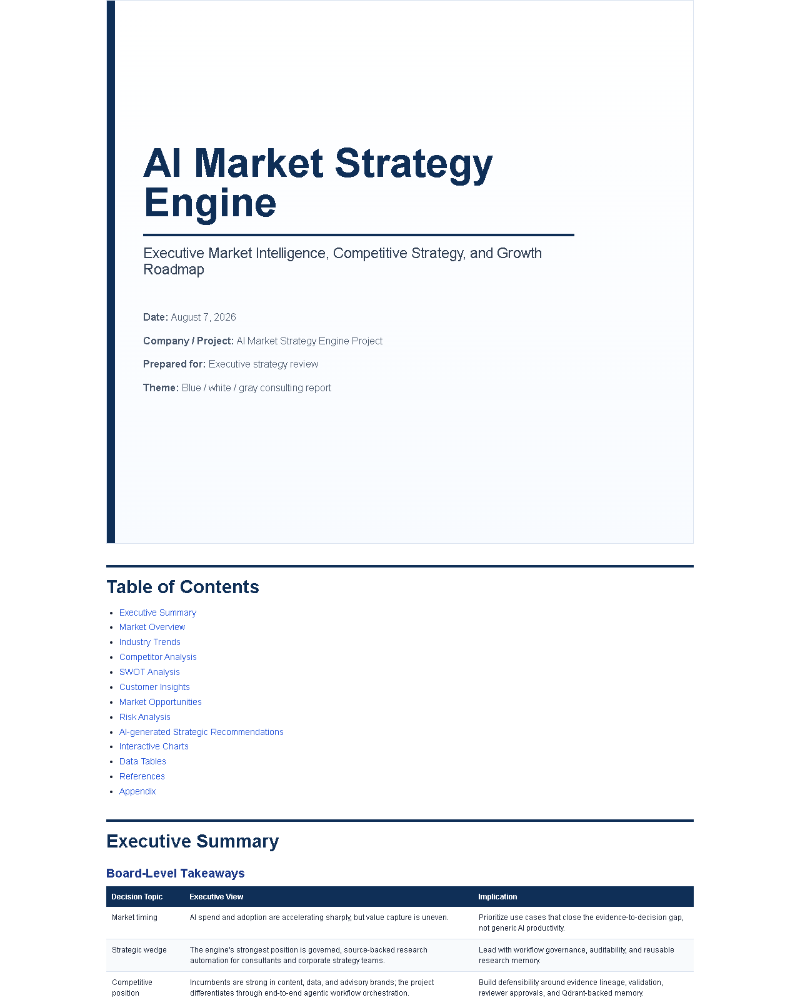 |
| Worldwide AI spending by market | 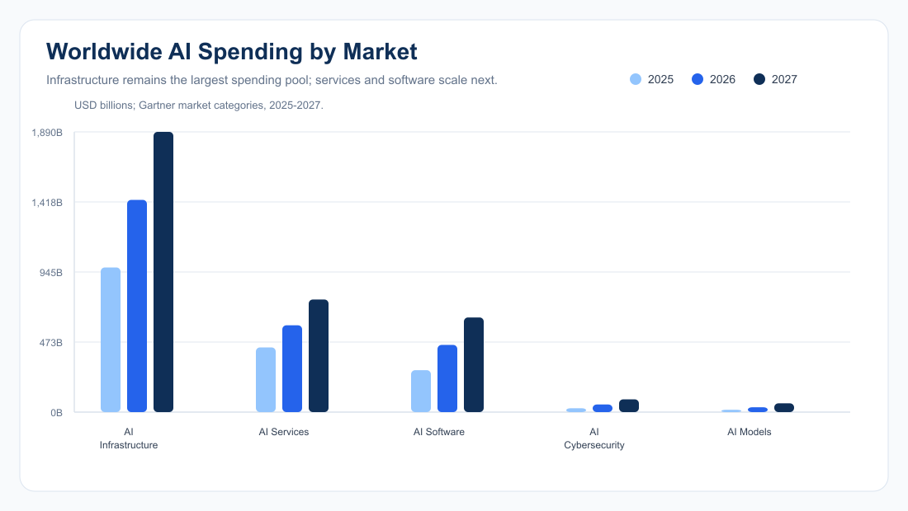 |
| AI adoption and value gap | 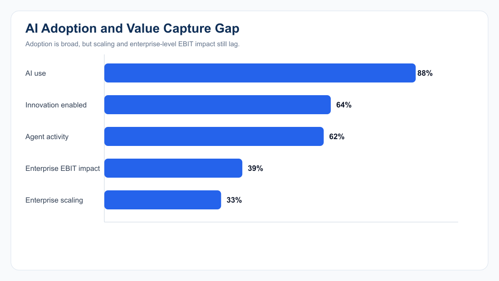 |
| Private AI investment gap | 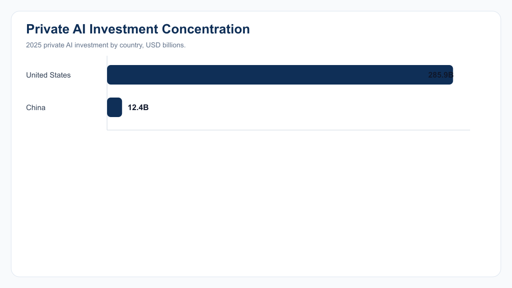 |
| Competitive capability index | 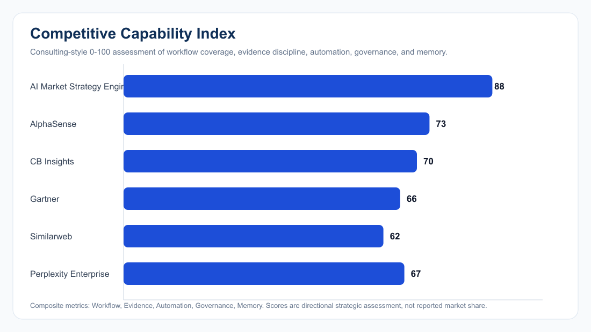 |
| Customer segments | 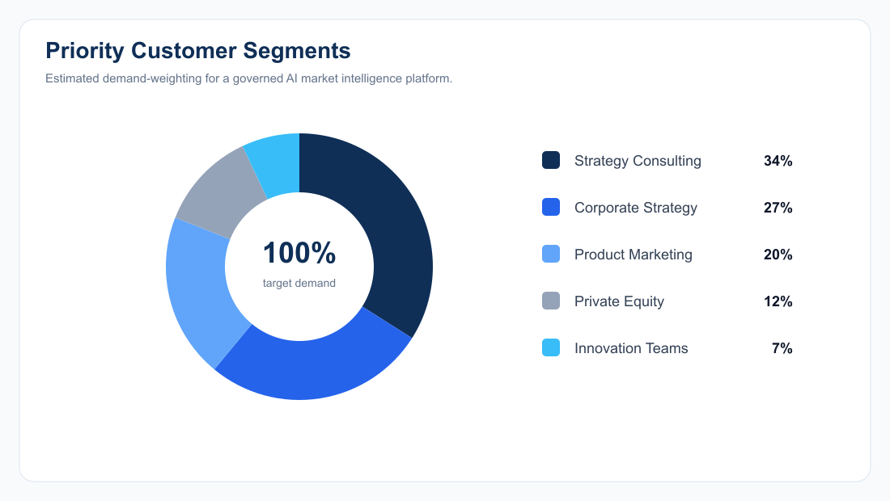 |
| Market opportunity ranking | 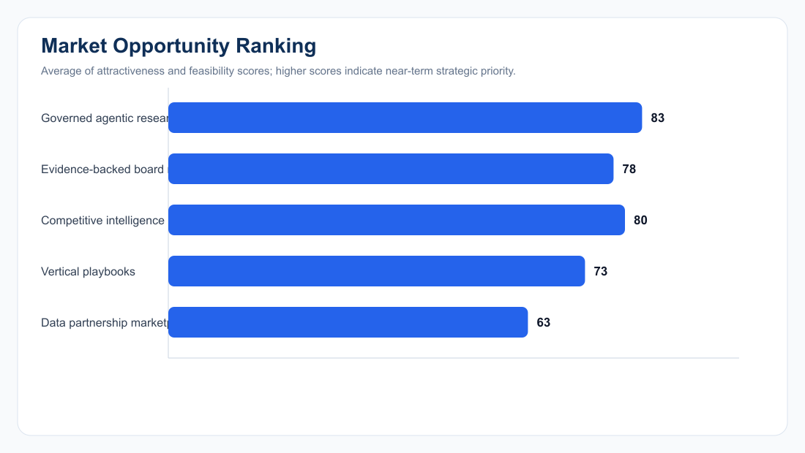 |
| Strategic risk heatmap | 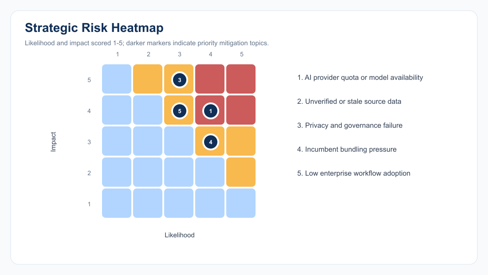 |
| SWOT radar | 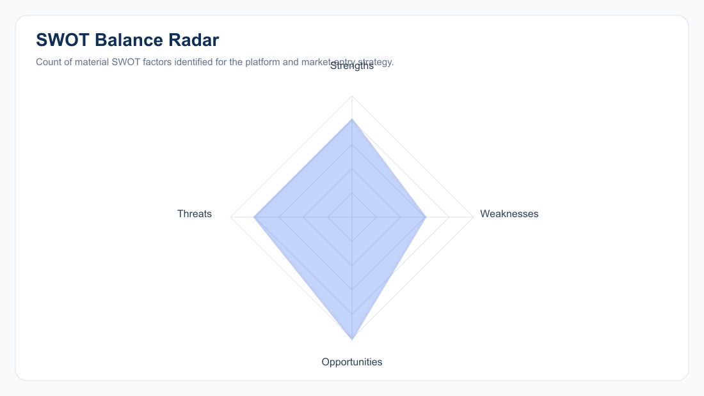 |
| AI governance risk indicators | 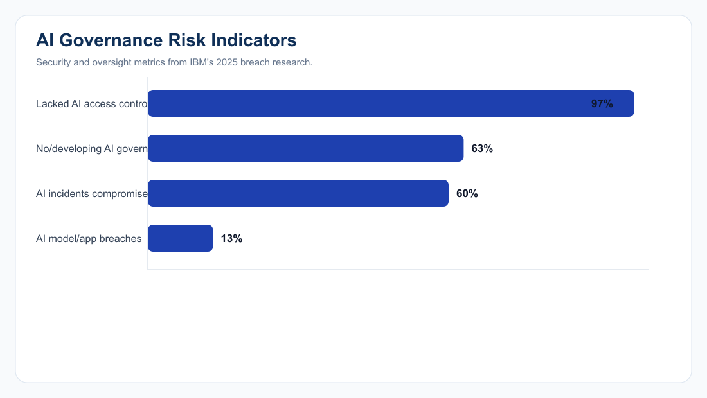 |

Major frontend pages present in source but without committed screenshots:

| Page | Route |
|---|---|
| Home | `/` |
| Login | `/login` |
| Signup | `/signup` |
| Forgot password | `/forgot-password` |
| Dashboard | `/dashboard` |
| Research intake | `/research-intake` |
| Workflow monitor | `/workflow-monitor` |
| Research plans | `/research-plans` |
| Reports | `/reports` |
| Evidence review | `/evidence-review` |
| Market intelligence | `/market-intelligence` |
| Competitive analysis | `/competitive-analysis` |
| Consumer insights | `/consumer-insights` |
| Forecasting | `/forecasting` |
| AI assistant | `/ai-assistant` |
| Knowledge base | `/knowledge-base` |
| Upload and data hub | `/upload-data-hub` |
| Data sources | `/data-sources` |
| Operations | `/operations` |
| Settings | `/settings` |
| Strategy builder | `/strategy-builder` |
| Porter's Five Forces | `/porters-five-forces` |
| SWOT analysis | `/swot-analysis` |
| Saved insights | `/saved-insights` |
| Templates | `/templates` |
| Notifications | `/notifications` |

## Testing

Run backend tests:

```bash
cd backend
npm test
```

Run frontend tests:

```bash
cd frontend
npm test
```

Backend tests are offline-safe and cover authentication behavior, route protection, CORS behavior, and research model validation. Frontend tests use Jest with the Next.js/JSDOM setup.

## Deployment

### Frontend: Vercel

The frontend includes `frontend/vercel.json`:

```json
{
  "framework": "nextjs",
  "buildCommand": "npm run build",
  "outputDirectory": ".next"
}
```

Deploy with project root set to:

```text
frontend
```

Build command:

```bash
npm run build
```

Frontend environment:

```bash
NEXT_PUBLIC_API_URL=/api
API_URL=https://agentic-research-strategy-api.onrender.com
```

Frontend deployment URL:

```text
https://agentic-research-strategy-engine.vercel.app/
```

### Backend: Render

Deploy with service root set to:

```text
backend
```

Build command:

```bash
npm ci
```

Start command:

```bash
npm start
```

Backend deployment URL:

```text
https://agentic-research-strategy-api.onrender.com
```

Backend API URL:

```text
https://agentic-research-strategy-api.onrender.com/api
```

Interactive API documentation (Swagger UI):

```text
https://agentic-research-strategy-api.onrender.com/api-docs
```

OpenAPI specification (JSON):

```text
https://agentic-research-strategy-api.onrender.com/api-docs.json
```

Health check:

```text
https://agentic-research-strategy-api.onrender.com/health
```

Render environment variables should be copied from `backend/.env.example`, with real production secrets and service credentials.

### Live Application URL

The deployed application is available at [https://agentic-research-strategy-engine.vercel.app/](https://agentic-research-strategy-engine.vercel.app/). The backend is deployed on [Render](https://agentic-research-strategy-api.onrender.com), and the interactive API reference is available at [Swagger UI](https://agentic-research-strategy-api.onrender.com/api-docs).

## Troubleshooting

| Problem | Cause | Fix |
|---|---|---|
| `MONGODB_URI is required in production` | Backend is running with `NODE_ENV=production` and no `MONGODB_URI` or `MONGO_URL`. | Set `MONGODB_URI` or `MONGO_URL` in `backend/.env` or the Render environment. |
| Local database connection fails | MongoDB is not running locally and no Atlas URI is configured. | Start local MongoDB or configure `MONGODB_URI`. |
| Atlas SRV DNS lookup fails | Network or DNS cannot resolve `mongodb+srv` records. | Set `DNS_SERVERS=8.8.8.8,1.1.1.1`, or use a non-SRV Atlas connection string. |
| Atlas handshake closes | Atlas network access, credentials, firewall, or TLS inspection problem. | Allowlist current IP in Atlas, verify user/password, and confirm outbound TLS to port `27017`. Use `MONGODB_TLS_ALLOW_INVALID_CERTIFICATES=true` only for local troubleshooting. |
| Browser requests fail with CORS error | Frontend origin is not in `CORS_ORIGIN`. | Add the frontend origin to the comma-separated `CORS_ORIGIN` list and restart the backend. |
| Protected endpoint returns `401` | Missing, expired, or invalid bearer token. | Log in again or call `/api/auth/refresh` with a valid refresh token. |
| Reviewer/admin endpoint returns `403` | User role lacks permission. | Use a `reviewer` or `admin` account for evidence review, knowledge creation, or operations metrics. |
| DeepSeek endpoints return `503` | `DEEPSEEK_API_KEY`, billing, quota, or model access is unavailable. | Set a valid key, confirm quota/billing, and configure `DEEPSEEK_MODEL_FALLBACKS`. See `docs/DEEPSEEK_RELIABILITY.md`. |
| Tavily research fails | `TAVILY_API_KEY` is missing. | Configure `TAVILY_API_KEY` in the backend environment. |
| Qdrant semantic search fails | `QDRANT_URL` or `QDRANT_API_KEY` is missing. | Configure both Qdrant variables or use local knowledge results without semantic search. |
| Upload rejected | Unsupported MIME type or no files were provided. | Upload PDF, DOCX, XLSX, CSV, PPT, or PPTX files with the multipart field name `files`. |

## Future Enhancements

- Add committed UI screenshots for every major page listed in the screenshots section.
- Keep the OpenAPI/Swagger specification synchronized with Express routes and Zod request schemas.
- Add admin-only user management for creating and managing admin accounts safely.
- Add background queue infrastructure for long-running research workflows.
- Add persisted report export URLs instead of only streaming generated files.
- Add richer upload extraction for DOCX, XLSX, PPTX, and CSV instead of plain text buffer extraction.
- Add provider health checks for DeepSeek, Tavily, Firecrawl, Qdrant, and MongoDB.
- Add automated end-to-end tests for the full research workflow with seeded data.
- Add observability dashboards for job latency, provider errors, token usage, and research success rate.

## Contributors

This project was developed collaboratively by the following five learners:

| Contributor |
|---|
| MD Sameer Alam |
| Kajal Kumari |
| Arvind Kumar |
| P. Deepthi |
| Dev Verma |

## License

No license file was found in the repository. Until a license is added, all rights are reserved by default and reuse permissions are unspecified.

## References and Documentation

| Resource | Description |
|---|---|
| [docs/API.md](docs/API.md) | Existing API route list. |
| [docs/ARCHITECTURE.md](docs/ARCHITECTURE.md) | Existing architecture and governance notes. |
| [docs/DEPLOYMENT.md](docs/DEPLOYMENT.md) | Existing Vercel and Render deployment guide. |
| [docs/TESTING.md](docs/TESTING.md) | Existing test coverage and test commands. |
| [docs/DEEPSEEK_RELIABILITY.md](docs/DEEPSEEK_RELIABILITY.md) | DeepSeek API quota or balance and provider troubleshooting notes. |
| [backend/src/app.js](backend/src/app.js) | Express app, middleware, route mounts, health check, CORS, and rate limiting. |
| [backend/src/routes](backend/src/routes) | Public API route definitions. |
| [backend/src/controllers](backend/src/controllers) | Request handling and response behavior. |
| [frontend/lib/api.js](frontend/lib/api.js) | Frontend API base URL resolution and Axios client. |
| [frontend/app](frontend/app) | Next.js App Router pages and API proxy. |
| [frontend/vercel.json](frontend/vercel.json) | Vercel deployment configuration. |
